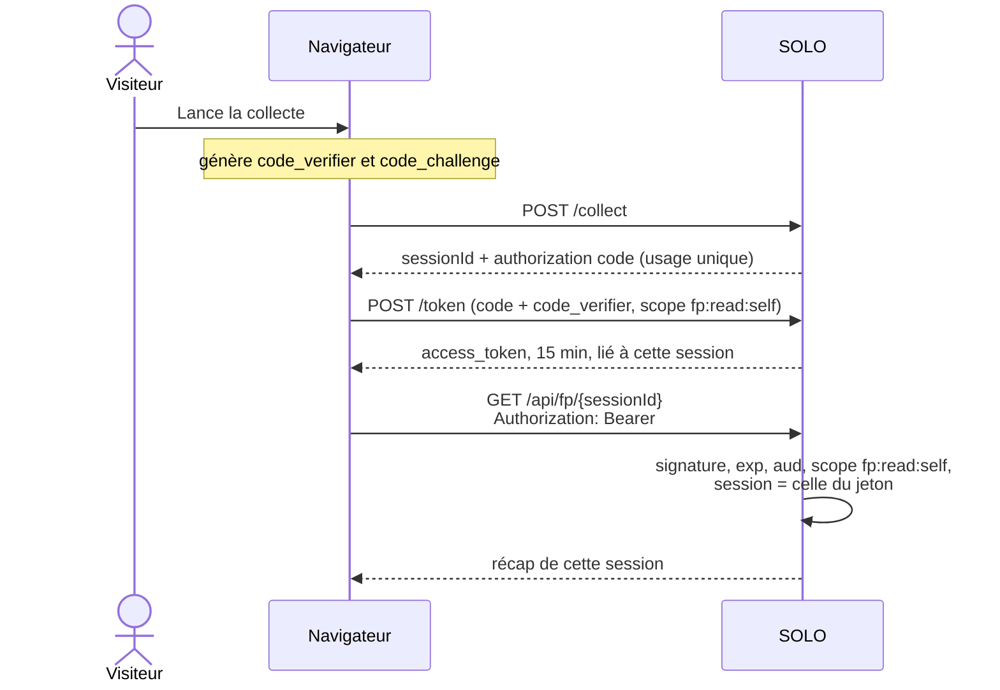
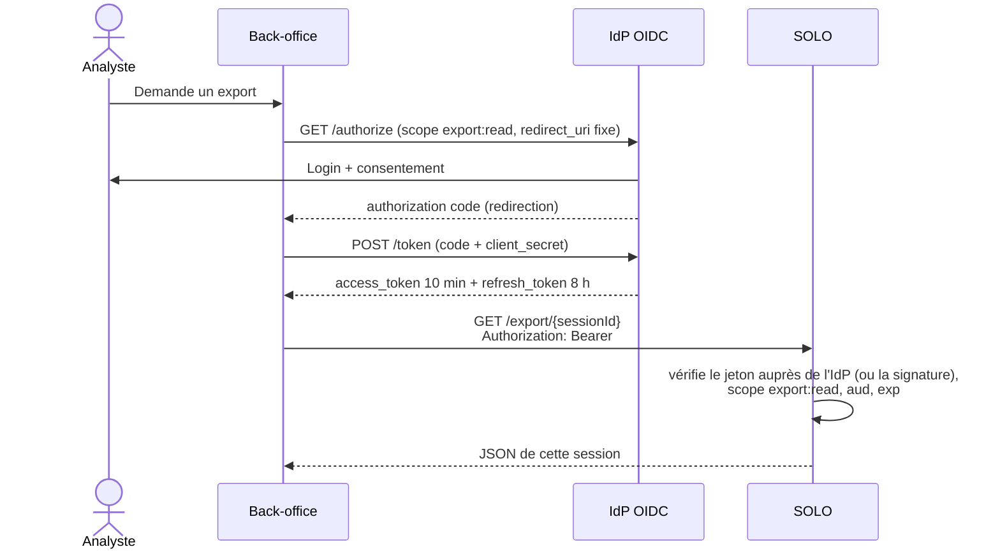
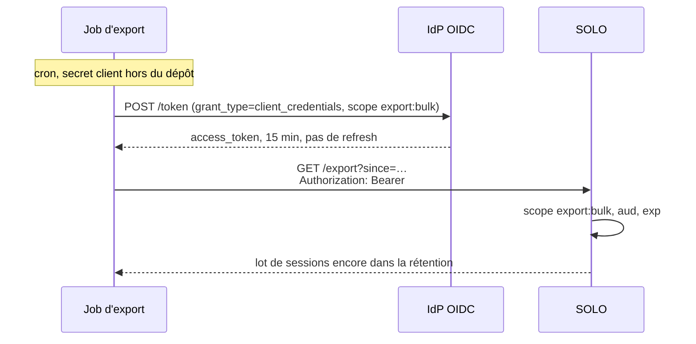

# E4 — Correction : l'authentification manquante de SOLO

L'énoncé d'E4 demande explicitement d'ouvrir `.env.example`. Ce fichier affirme qu'il n'y a aucune authentification applicative, et que les accès reposent seulement sur l'UUID dans l'URL.

La note, lignes 39 à 44, dit ceci :

- `/api/fp/:id` et `/export/:id` ne sont protégés que par l'UUID généré par le serveur et placé dans l'URL ;
- `/collect` est ouvert et rate-limité (15 requêtes par minute dans `routes.ts`) ;
- les anciens `SESSION_SECRET` et `ADMIN_TOKEN` ont été retirés, parce que rien dans le code ne les lisait. En renseigner un donnait une protection qui n'existait pas.

Cette note confirme que SOLO est dans le modèle « URL-capacité » avant de choisir un flux OAuth par acteur. `POST /collect` renvoie `recapUrl: /recap/${sessionId}`. Connaître l'URL suffit : l'adresse est aussi la clé.

## Qu'est-ce qu'un UUID

Un UUID (Universally Unique Identifier, identifiant unique universel) est un nombre de 128 bits, écrit en hexadécimal sur cinq groupes :

```text
xxxxxxxx-xxxx-Mxxx-Nxxx-xxxxxxxxxxxx
```

Exemple : `7c9e6679-7425-40de-944b-e07fc1f90ae7`. Le `M` indique la version. SOLO n'accepte qu'un UUID **version 4** : `routes.ts` le vérifie avec l'expression `UUID_V4`, et `POST /collect` le crée avec `randomUUID()` (`node:crypto`). Dans un v4, 122 bits sont tirés au hasard. On ne le devine pas en le parcourant.

Ce n'est ni un mot de passe, ni un chiffrement, ni une signature. C'est un identifiant. Dans SOLO il joue malgré tout le rôle d'une clé, parce que `GET /api/fp/:id` et `GET /export/:id` renvoient la session à quiconque présente cet identifiant dans l'URL. Le secret n'est pas dans un en-tête `Authorization`. Il est dans l'adresse, donc il se copie, se journalise et se retrouve dans l'historique.

La rétention des sessions est d'une heure. Un jeton plus long que la donnée qu'il protège ne sert à rien.

## 1. Où l'URL-capacité fuite

L'UUID est imprévisible (`randomUUID()` côté serveur), mais il voyage dans l'URL. Quatre fuites suffisent à le sortir du navigateur du visiteur :

1. **Historique du navigateur.** `/recap/<uuid>`, `/api/fp/<uuid>` et `/export/<uuid>` restent dans l'historique. Un autre utilisateur du poste, ou une sauvegarde du profil, relit la session tant que le TTL d'une heure n'est pas passé.
2. **Logs d'un proxy ou d'un reverse-proxy.** Nginx, le pare-feu du LXC ou un proxy d'entreprise écrivent la requête complète dans `access.log`. Le fichier de logs devient une liste de clés encore valides.
3. **En-tête `Referer`.** La page `/recap/:id` charge ensuite des ressources. Si l'une est tierce (police, script, mesure d'audience), le navigateur envoie l'URL complète, UUID compris, à ce tiers.
4. **Capture d'écran ou épaulement.** La barre d'adresse affiche le secret. Une photo, un partage d'écran ou quelqu'un derrière l'épaule copie l'URL.

Deux autres canaux du même type : les journaux applicatifs si l'URL y est écrite en clair, et un copier-coller du lien de récap dans un mail, un chat ou un ticket.

Le serveur ne distingue pas le visiteur légitime de celui qui a récupéré l'URL. Révoquer le lien coupe aussi l'accès de la personne à qui il était destiné.

## 2. Acteurs

| Acteur | Besoin | Client OAuth | Flux |
|---|---|---|---|
| Visiteur | Lire son propre récap, rien d'autre | Public (le navigateur) | Authorization Code + PKCE |
| Analyste data | Exporter des sessions, une par une, pour un modèle | Confidentiel (back-office) | Authorization Code + OIDC |
| Job d'export, chaque nuit | Vider le lot de sessions sans personne devant l'écran | Confidentiel (machine) | Client Credentials |

`/collect` reste anonyme et rate-limité : le visiteur n'a pas encore de jeton au moment de la collecte. L'authentification protège la lecture et l'export.

## 3. Diagrammes de séquence

### Visiteur — Authorization Code + PKCE

Le navigateur ne peut pas garder un secret. PKCE lie le code d'autorisation au navigateur qui l'a demandé. SOLO émet le code au moment de la collecte et le rattache à une seule session. L'UUID ne figure plus dans l'URL comme clé d'accès.



Un code intercepté sans le `code_verifier` ne donne pas de jeton. Le jeton ne lit pas une autre session.

### Analyste — Authorization Code + OIDC

Une personne identifiée, devant un back-office qui peut garder un secret (client confidentiel). L'IdP authentifie l'analyste. SOLO ne reçoit que le code, puis un jeton dont le scope a été consenti.



Le refresh token tourne à chaque usage. Un refresh présenté deux fois est révoqué, ainsi que la famille de jetons.

### Job de nuit — Client Credentials

Personne n'est là pour se connecter. Le job s'authentifie par ses propres identifiants et ne reçoit qu'un access token. Pas de refresh token : le secret client reste dans le coffre du job, et un nouveau jeton est demandé au début de chaque exécution.



`export:bulk` n'est pas accordé au navigateur ni à l'analyste interactif.

## 4. Scopes et durées

| Scope | Qui | Droit | Access token | Refresh token |
|---|---|---|---|---|
| `fp:read:self` | Visiteur | Lire uniquement la session liée au jeton | 15 min | Aucun. La session expire de toute façon au bout d'1 h |
| `export:read` | Analyste | Exporter une session désignée | 10 min | 8 h, rotation à chaque usage, révocation si réutilisation |
| `export:bulk` | Job de nuit | Exporter le lot | 15 min, demandé au lancement du cron | Aucun |

Vérifications communes, quel que soit le flux : signature du jeton, `exp`, `aud` fixé à SOLO, algorithme imposé (pas `none`), et scope exact. Un jeton `fp:read:self` présenté à `/export/:id` est refusé. Un jeton `export:read` présenté sur une session qui n'est pas celle demandée passe, parce que l'analyste a le droit d'export unitaire ; il ne passe pas sur un export de masse.

`/collect` ne consomme aucun de ces scopes. Il reste limité à 15 requêtes par minute et par clé réseau, comme aujourd'hui.
